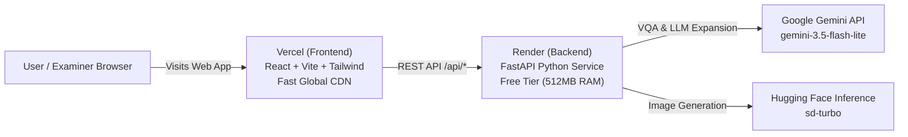

# Deployment Guide — Visual Question Answering (VQA) Studio

This guide outlines **step-by-step instructions for hosting the Backend on Render and the Frontend on Vercel**, plus alternative free methods.

---

## 🏆 Recommended Architecture: Render (Backend) + Vercel (Frontend)



### Why this architecture works:
1. **Frontend on Vercel:** 100% Free, instant global deployment, clean `https://*.vercel.app` URL for project submission.
2. **Backend on Render:** 100% Free Python web service, automatic HTTPS, handles all API requests.
3. **Low-Memory Protection (`LOW_MEMORY_MODE=true`):** Render Free tier provides **512 MB RAM**. Local unquantized BLIP in PyTorch uses ~1.35 GB of RAM (which causes Linux kernel OOM Exit 137). Setting `LOW_MEMORY_MODE=true` routes VQA through Gemini Vision, keeping backend RAM at **~120 MB** so Render runs smoothly and never crashes.

---

### Step 1: Push Code to GitHub

1. Initialize and commit your local project:
   ```bash
   cd c:\Users\salun\OneDrive\Desktop\visual-question-answering
   git add .
   git commit -m "feat: configure Render backend and Vercel frontend"
   ```
2. Create a new repository on [GitHub](https://github.com/new) (e.g. `visual-question-answering`).
3. Push your repository:
   ```bash
   git remote add origin https://github.com/<YOUR_GITHUB_USERNAME>/visual-question-answering.git
   git branch -M main
   git push -u origin main
   ```

---

### Step 2: Deploy Backend on Render

1. Log in to [Render](https://render.com) (free account).
2. Click **New +** $\rightarrow$ **Web Service**.
3. Select **Build and deploy from a Git repository** and connect your `visual-question-answering` repo.
4. Fill in the service configuration:
   - **Name:** `vqa-studio-backend`
   - **Region:** Any (e.g., `Oregon (US West)` or `Frankfurt (EU)`)
   - **Branch:** `main`
   - **Root Directory:** *(leave blank)*
   - **Runtime:** `Python 3`
   - **Build Command:** `pip install -r requirements-render.txt`
   - **Start Command:** `uvicorn backend.main:app --host 0.0.0.0 --port $PORT`
   - **Instance Type:** `Free` (0.1 CPU · 512 MB RAM)
5. Scroll down to **Environment Variables** and add:
   - `GEMINI_API_KEY`: *(your Google AI Studio key)*
   - `HF_TOKEN`: *(your Hugging Face token)*
   - `GEMINI_MODEL`: `gemini-3.5-flash-lite`
   - `IMAGE_PROVIDER`: `hf`
   - `LOW_MEMORY_MODE`: `true` *(Crucial: keeps memory ~120MB to prevent Render 512MB OOM crash)*
6. Click **Create Web Service**.
7. Wait ~2 minutes for the build to finish. Once live, Render displays your backend URL:
   `https://vqa-studio-backend.onrender.com`
8. Verify the backend health:
   `https://vqa-studio-backend.onrender.com/api/health`

---

### Step 3: Deploy Frontend on Vercel

1. Log in to [Vercel](https://vercel.com).
2. Click **Add New...** $\rightarrow$ **Project**.
3. Import your `visual-question-answering` GitHub repository.
4. Configure the project:
   - **Framework Preset:** `Vite`
   - **Root Directory:** Click **Edit** and select `frontend`
   - **Build Command:** `npm run build`
   - **Output Directory:** `dist`
5. Expand **Environment Variables** and add:
   - `VITE_API_URL`: `https://vqa-studio-backend.onrender.com` *(your Render backend URL from Step 2, no trailing slash)*
6. Click **Deploy**.
7. In ~30 seconds, Vercel gives you your live URL:
   `https://visual-question-answering.vercel.app`

---

### ⚠️ Important Notice About Render Free Tier
- **Cold Sleep:** Render free web services spin down after 15 minutes of inactivity. When someone first visits the site, the first API request may take **40–50 seconds** while Render spins the container back up. All subsequent requests respond in ~300ms.
- **Tip for Viva/Evaluation:** Open the site 1 minute before your demonstration so Render is already warm!

---

## 🎯 Emergency Alternative: Cloudflare Tunnel (Instant Live Demo with Full Local PyTorch BLIP)

If you have a live viva or practical presentation and want **zero cold-sleep lag** and **full 1.35GB local PyTorch BLIP CPU inference**:

1. Run the local backend:
   ```bash
   .\.venv\Scripts\python.exe -m uvicorn backend.main:app --host 127.0.0.1 --port 7860
   ```
2. In a second terminal:
   ```bash
   cloudflared tunnel --url http://127.0.0.1:7860
   ```
   *(Or using `npx ngrok http 7860`)*
3. Share the public HTTPS URL (e.g. `https://xyz.trycloudflare.com`) with your examiner!
