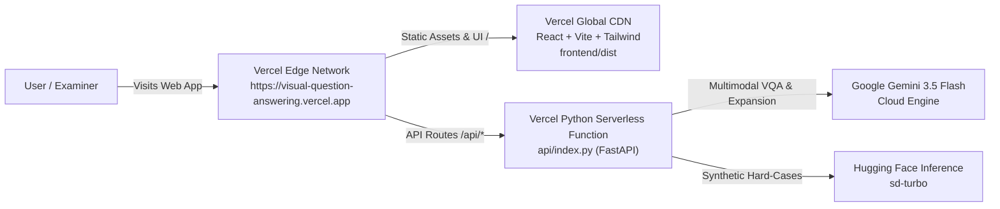

# Deployment Guide — Visual Question Answering (VQA) Studio

This guide outlines **how to deploy the entire project (Frontend + Backend) 100% on Vercel**, plus emergency viva backup options.

---

## 🏆 Top Recommendation: Deploy Full Project on Vercel Only (100% Free)

Both the **Vite + React frontend** and the **FastAPI Python backend** run seamlessly together on **Vercel** under a single domain with zero configuration.



### Why Full Vercel is the Best Choice:
1. **One Single URL:** The examiner only needs one link: `https://visual-question-answering.vercel.app`.
2. **Instant Response (No Cold Sleep):** Unlike Render's free tier which sleeps after 15 minutes and takes 50 seconds to wake up, Vercel Serverless Functions wake up in milliseconds.
3. **Zero CORS Issues:** Frontend and backend share the exact same origin.
4. **100% Free:** Completely covered by Vercel's free Hobby plan.

---

### Step-by-Step Vercel Deployment Instructions

#### Step 1: Push the Latest Code to GitHub
Open PowerShell in your project directory:
```powershell
cd c:\Users\salun\OneDrive\Desktop\visual-question-answering
git add .
git commit -m "feat: configure full-stack Vercel deployment with serverless API"
git push
```

#### Step 2: Import Project in Vercel
1. Log in to your [Vercel Dashboard](https://vercel.com).
2. Click **Add New...** $\rightarrow$ **Project**.
3. Locate your GitHub repository (`ParasSalunke/visual-question-answering`) and click **Import**.
4. In the configuration screen:
   - **Root Directory:** Leave as `./` (do **not** change it to `frontend`; keep it at root so Vercel builds both the frontend and `api/index.py`).
   - **Framework Preset:** `Vite` (or `Other`).
   - Notice that Vercel automatically reads [`vercel.json`](file:///c:/Users/salun/OneDrive/Desktop/visual-question-answering/vercel.json):
     - *Build Command:* `cd frontend && npm install && npm run build`
     - *Output Directory:* `frontend/dist`
5. Expand **Environment Variables** and add:
   - `GEMINI_API_KEY`: *(your Google AI Studio key)*
   - `HF_TOKEN`: *(your Hugging Face token)*
   - `GEMINI_MODEL`: `gemini-3.5-flash-lite`
   - `IMAGE_PROVIDER`: `hf`
   - `LOW_MEMORY_MODE`: `true`
6. Click **Deploy**.

#### Step 3: Verify Your Live Deployment
Within ~45 seconds, Vercel gives you your live production URL:
- **Web App:** `https://visual-question-answering.vercel.app`
- **Health Check:** `https://visual-question-answering.vercel.app/api/health`
- **Interactive Evaluation:** `https://visual-question-answering.vercel.app/#/evaluation`

---

## 🎯 Emergency Backup: Cloudflare Tunnel (Instant Live Demo with Full Local PyTorch BLIP)

If you are presenting live in a viva and want to demonstrate the **local 1.35GB PyTorch BLIP model** running at full local speed:

1. Start your local server:
   ```powershell
   .\.venv\Scripts\python.exe -m uvicorn backend.main:app --host 127.0.0.1 --port 7860
   ```
2. In a second PowerShell window, run:
   ```powershell
   cloudflared tunnel --url http://127.0.0.1:7860
   ```
   *(Or using `npx ngrok http 7860`)*
3. Cloudflare gives you an instant public HTTPS URL (e.g. `https://xyz.trycloudflare.com`) routing straight to your local PyTorch runtime!
